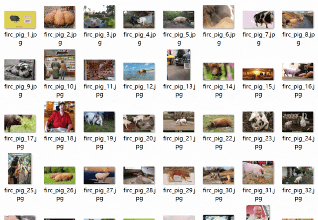
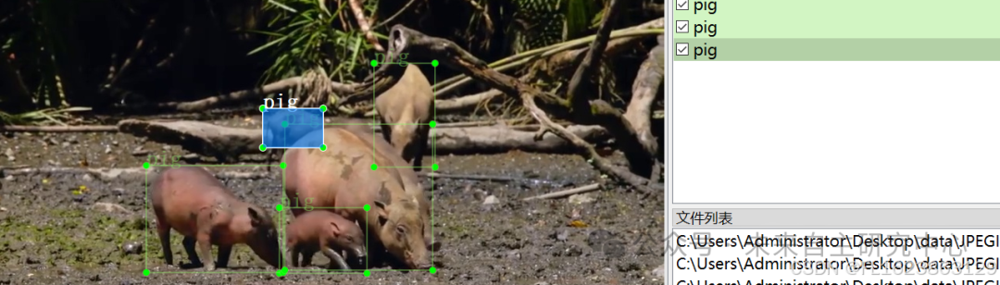

# [Dataset] Object Detection - Pig Dataset: VOC-2856 images

Dataset format: Pascal VOC format (excluding splitted txt files, only including jpg images and corresponding xml)
Number of images (number of jpg files): 2856
Number of annotations (number of xml files): 2856
Number of annotation categories: 1
Annotation category names: ["pig"]
Number of bounding boxes per category:
pig count = 5335

Using labeling tool: labelImg
Labeling rules: Draw a rectangle around the category.
Important note: No specifics provided.
Special declaration: This dataset does not guarantee the accuracy or precision of the trained models or weight files; the dataset only provides accurate and reasonable labeling.

Image Preview:

Annotation example:

## Payment

Here is a pay link on Stripe ( https://buy.stripe.com/3cs8yP7sY87d0vu9AB ). Please contact me lonlonago@foxmail.com after funding $89, and I will send you a complete data files , thank you!

